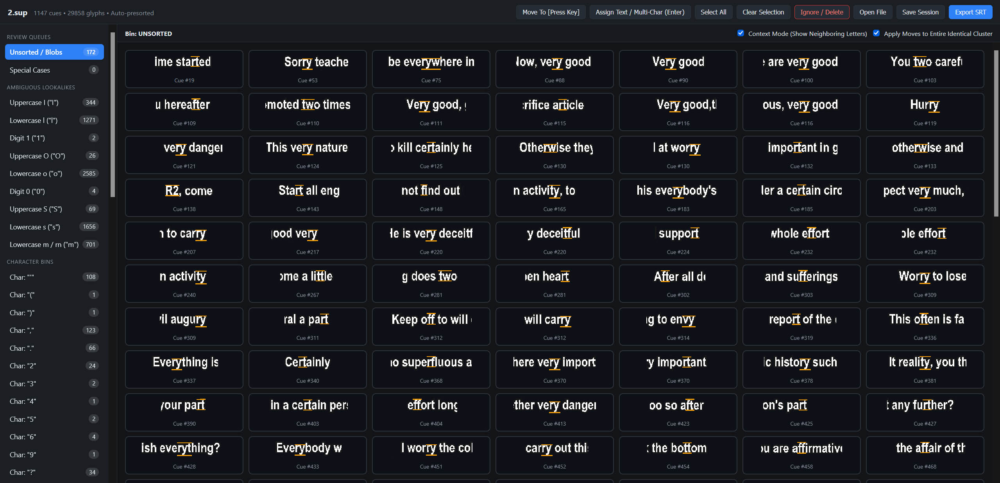

# SubSelector

**Rapid visual subtitle OCR in HTML5**



## What Is SubSelector?

SubSelector is a visual Optical Character Recognition (OCR) tool designed for **DVD (`.sup` / `.sub`)** and **Blu-ray PGS (`.sup`)** bitmap subtitles, allowing you to review and fix hundreds of characters at once through an interactive web-based grid.

---

## Supported Source Subtitle Formats

SubSelector reads the following formats directly:
1. **Raw DVD SubPicture Streams (`.sup`)**
2. **DVD VobSub Streams (`.sub`)**
3. **Blu-ray Presentation Graphic Stream (`.sup`)**
4. **Saved SubSelector Sessions (`.ocr_session.json`)**

> **Note:** SubSelector works on image/bitmap subtitle files only, not text formats like `.srt` or `.ass`.

---

## System Requirements

* **Python 3** (3.6 or newer; optional `tkinter` for pop-up file pickers)
* **Required Libraries:** `numpy` and `Pillow` (`PIL`)
* **HTML5 Browser:** Modern browser supporting `<dialog>`, CSS Grid, and ES2017 JavaScript
* **Hardware:** Enough CPU speed for glyph segmentation and 250–500 MB of free RAM

---

## Part 1: Installation Guide

### 1. Windows (Windows 10 / 11)
1. Download and run the installer from [python.org/downloads](https://python.org), checking **`Add python.exe to PATH`**.
2. Open Command Prompt (`Win + R` -> `cmd`) and run:
   ```cmd
   python -m pip install numpy pillow
   ```
3. Run SubSelector via `SubSelector.py` or command line.

### 2. Linux (Ubuntu, Debian, Linux Mint, Fedora, Arch)
Use your system package manager to install Python 3, `tkinter`, `numpy`, and `Pillow`, then launch the script:
* **Ubuntu / Mint / Debian:** `sudo apt update && sudo apt install -y python3 python3-tk python3-numpy python3-pil && python3 SubSelector.py`
* **Fedora:** `sudo dnf install -y python3 python3-tkinter python3-numpy python3-pillow && python3 SubSelector.py`
* **Arch Linux:** `sudo pacman -S tk python-numpy python-pillow && python3 SubSelector.py`

### 3. Macintosh (Apple Silicon M1–M4 & Intel Macs)
1. Install the official universal2 installer from [python.org/downloads/macos](https://python.orgmacos/).
2. Open Terminal and install required libraries:
   ```bash
   python3 -m pip install numpy pillow
   ```
3. Launch by typing `python3 ` and dragging `SubSelector.py` into Terminal.

### 4. Mac OS X (PowerPC G4 / G5 — OS X 10.5.8 Leopard)
Compile Python 3.6 and dependencies via **MacPorts** (note that compiling `numpy` on G4/G5 hardware can take 30–60+ minutes):
```bash
sudo port install python36 py36-tkinter py36-numpy py36-pillow
python3.6 SubSelector.py movie.sup
```

---

## Part 2: How to Use the SubSelector Interface

### 1. Screen Layout
* **Top Toolbar:** Controls for moving tiles, assigning text, bulk selection, ignoring noise, opening/saving sessions, and exporting `.srt` files.
* **Left Sidebar (Bins):** Contains review queues (`Unsorted / Blobs`, `Special Cases`), ambiguous lookalikes, and standard character bins.
* **Sub-Bar Options:** Toggle **Context Mode** (view surrounding words) and **Apply Moves to Entire Identical Cluster**.

### 2. Step-by-Step Workflow
* **Step A: Sort Out "Unsorted / Blobs":** Resolve touching/bleeding letters or degraded glyphs, type the correct text, and send them to `Special Cases` (batch-moving identical copies across the file).
* **Step B: Review "Ambiguous Lookalikes":** Distinguish between `I` / `l` / `1`, `O` / `o` / `0`, `S` / `s`, and `m` / `rn` using Context Mode.
* **Step C: Quick Scan of Remaining Character Bins:** Catch any stray misclassified letters.
* **Step D: Saving Sessions & Exporting SRT:** Save your progress to `.ocr_session.json` or export the finished `.srt` file.

---

## Keyboard Shortcuts

| Shortcut | Action |
| :--- | :--- |
| **Click Tile** | Toggle selection on/off (or open dialog in `Unsorted / Blobs`) |
| **Move To + `[Any Key]`** | Move all selected tiles to that character's bin |
| **`Enter` (with selection)** | Open the Assign Text / Multi-Char dialog |
| **`Enter` (inside dialog)** | Save typed text to Special Cases and close dialog |
| **`Escape`** | Cancel Move To mode, close dialog, or clear selection |

---

## Non-English Latin Languages & License
SubSelector supports accented and diacritic characters (`é`, `à`, `ü`, `ñ`, etc.); see [`NON_ENGLISH_LATIN_GUIDE.txt`](NON_ENGLISH_LATIN_GUIDE.txt) for language-specific details. Licensed under the [GNU General Public License v3.0](LICENSE).
